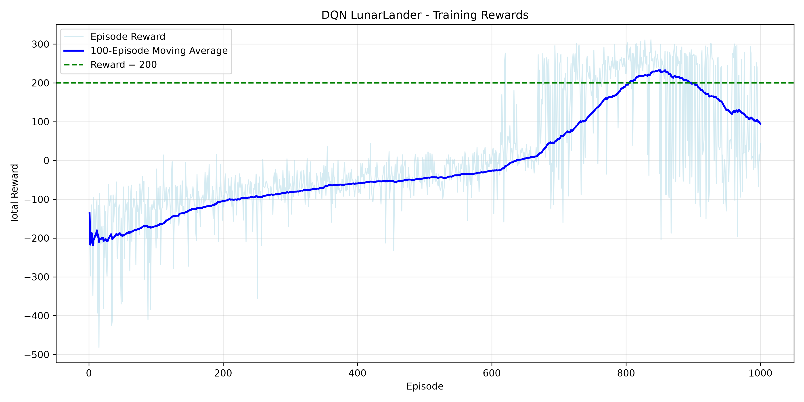
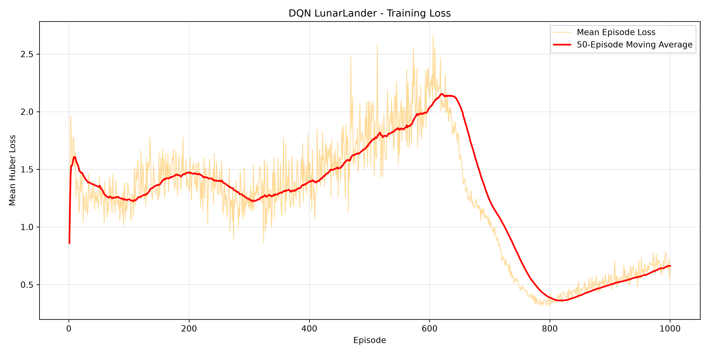
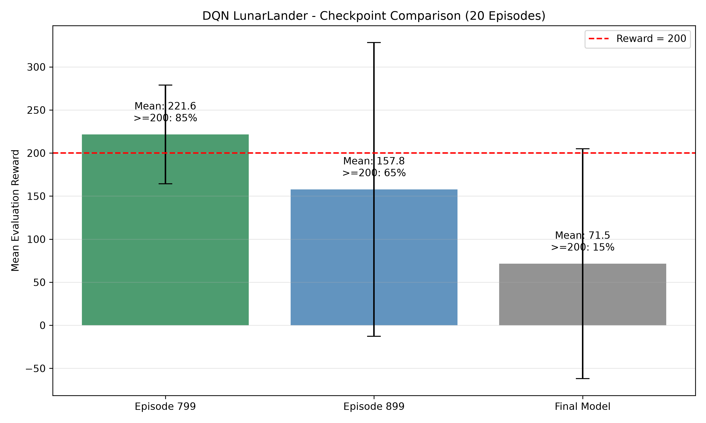

# LunarLander with Deep Q-Network (DQN)

A reinforcement learning project that trains a **Deep Q-Network (DQN)** agent to control a lunar lander in Gymnasium's `LunarLander-v3` environment. The agent learns from experience replay and bootstrapped Q-learning targets, without being given a model of the environment's dynamics.

## Highlights

- Implemented DQN using **PyTorch** with a separate policy network and target network.
- Used an **experience replay buffer**, **epsilon-greedy exploration**, **Huber loss**, and periodic target-network updates.
- Trained for **1,000 episodes**, saving intermediate checkpoints.
- Evaluated three checkpoints over **20 episodes using the same fixed seeds**, with greedy action selection (`epsilon = 0`).
- Selected **checkpoint 799** as the best of the three evaluated models: **221.62 mean reward** and **85% of episodes scoring at least 200**.

## Environment

`LunarLander-v3` provides an 8-dimensional observation and four discrete actions.

| Observation features | Available actions |
| --- | --- |
| Horizontal and vertical position | `0` — do nothing |
| Horizontal and vertical velocity | `1` — fire left orientation engine |
| Lander angle and angular velocity | `2` — fire main engine |
| Left and right leg-ground contact indicators | `3` — fire right orientation engine |

The goal is to control the lander to land safely while balancing fuel usage, position, orientation, and velocity.

## Approach

The Q-network is a multilayer perceptron with the following architecture:

```text
State (8)
   ↓
Linear(8, 128) + ReLU
   ↓
Linear(128, 128) + ReLU
   ↓
Linear(128, 4)
   ↓
Q-values for the four actions
```

The agent selects actions using an epsilon-greedy policy during training. Each transition `(state, action, reward, next_state, terminated)` is stored in a replay buffer. Mini-batches are sampled to minimize the Huber loss between predicted Q-values and one-step DQN targets:

\[
y = r + \gamma(1 - \mathrm{terminated})\max_{a'}Q_{\mathrm{target}}(s',a')
\]

The target network is periodically synchronized with the policy network to reduce instability from rapidly changing targets.

### Training configuration

| Setting | Value |
| --- | --- |
| Environment | `LunarLander-v3` |
| Training episodes | 1,000 |
| Optimizer | Adam |
| Learning rate | 0.0005 |
| Discount factor (`gamma`) | 0.99 |
| Replay buffer capacity | 100,000 transitions |
| Batch size | 64 |
| Hidden layers | 2 × 128 neurons, ReLU |
| Loss | Huber (Smooth L1) |
| Exploration (`epsilon`) | Linearly decayed from 1.0 to 0.05 over 100,000 environment steps |
| Target-network synchronization | Every 1,000 environment steps |

Episodes end on either termination or truncation; the stored terminal flag is `terminated`, which is used to control bootstrapping in the DQN target.

## Results

### Training reward



Rewards generally improved from negative values early in training to positive values after roughly 600 episodes. The 100-episode moving average rose above 200 before declining later in training, illustrating that additional DQN updates do not guarantee better policy performance.

### Training loss



The loss fluctuates because DQN learns from bootstrapped targets that evolve throughout training. A decreasing loss alone does not guarantee that the resulting policy performs better.

### Checkpoint evaluation



Each checkpoint was evaluated for **20 episodes with the same initial seeds**, using **greedy action selection** and no exploration.

| Model | Mean reward | Reward standard deviation | Episodes with reward ≥ 200 |
| --- | ---: | ---: | ---: |
| **Checkpoint 799** | **221.62** | **57.24** | **85%** |
| Checkpoint 899 | 157.84 | 170.61 | 65% |
| Final model (episode 999) | 71.52 | 133.50 | 15% |

**Checkpoint 799** performed best among the three models tested, both in average reward and consistency. The percentage above 200 is a **score-threshold metric**, not a direct measurement of physically successful landings. These results describe one training run and a 20-episode evaluation sample; they should not be interpreted as guarantees of performance across all random seeds.

## Project structure

```text
LunarLander/
├── src/
│   ├── environment.py       # Explore the Gymnasium environment
│   ├── replay_buffer.py     # Experience replay storage and sampling
│   ├── network.py           # PyTorch Q-network
│   ├── dqn_agent.py         # DQN action selection and learning updates
│   ├── train.py             # Training loop and checkpoints
│   ├── evaluation.py        # Greedy policy evaluation
│   └── visualize.py         # Training and evaluation plots
├── results/
│   ├── models/              # Saved model weights and checkpoints
│   ├── metrics/
│   │   └── training_metrics.csv
│   └── plots/
│       ├── training_rewards.png
│       ├── training_loss.png
│       └── checkpoint_comparison.png
├── requirements.txt
└── README.md
```

## Getting started

### 1. Create and activate a virtual environment

On Windows PowerShell:

```powershell
python -m venv .venv
.\.venv\Scripts\Activate.ps1
```

On macOS or Linux:

```bash
python3 -m venv .venv
source .venv/bin/activate
```

### 2. Install dependencies

```bash
python -m pip install --upgrade pip
python -m pip install -r requirements.txt
```

**Note:** Gymnasium's Box2D extra requires native Box2D dependencies. If installation fails, consult the [Gymnasium Box2D installation instructions](https://gymnasium.farama.org/environments/box2d/) for your operating system and Python version.

### 3. Train an agent

```bash
python -m src.train
```

Training writes model checkpoints to `results/models/` and training metrics to `results/metrics/`.

### 4. Evaluate saved checkpoints

```bash
python -m src.evaluation
```

The evaluation script compares the model paths listed in its `__main__` block. Ensure those checkpoint files exist before running it. For faster batch evaluation, disable human rendering in `src/evaluation.py`.

### 5. Generate plots

```bash
python -m src.visualize
```

Plots are saved in `results/plots/`. The checkpoint comparison chart currently uses the fixed-seed evaluation results recorded in `src/visualize.py`; update those values if you rerun the experiment.

## Lessons learned

- **Replay buffers** make it possible to reuse experience and reduce the correlation between successive training updates.
- **Target networks** stabilize DQN training by holding the bootstrapping network fixed between synchronizations.
- **Exploration schedules** affect both learning speed and the experiences available for training.
- **Training loss and policy reward are different signals**: lower loss does not necessarily imply better control.
- **Checkpoint evaluation matters**: the final weights were substantially weaker than an earlier checkpoint in this run.
- **Fixed evaluation seeds** make comparisons more controlled, although larger evaluation sets and multiple training seeds would give stronger evidence.

## Possible extensions

- Automatically evaluate and save the best-performing checkpoint during training.
- Repeat training across multiple random seeds and report aggregate performance.
- Compare vanilla DQN against **Double DQN** or **Dueling DQN**.
- Record a video of the greedy policy using the best checkpoint.

## Tools and libraries

Python, PyTorch, Gymnasium (Box2D), NumPy, Pandas, and Matplotlib.
